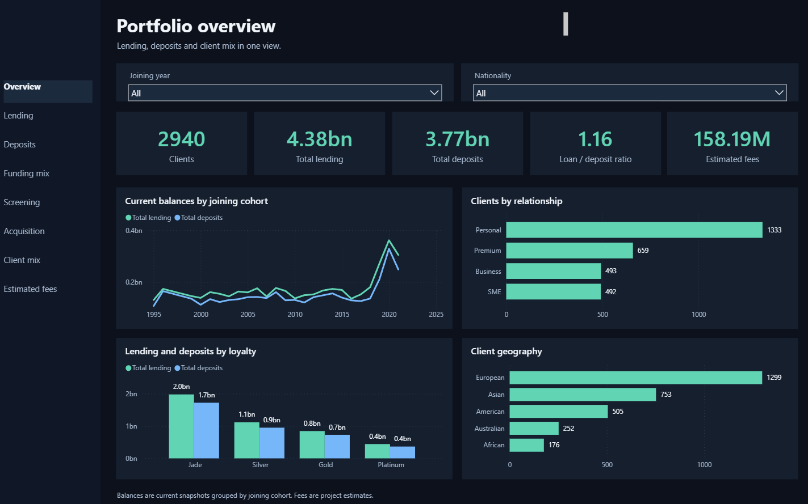
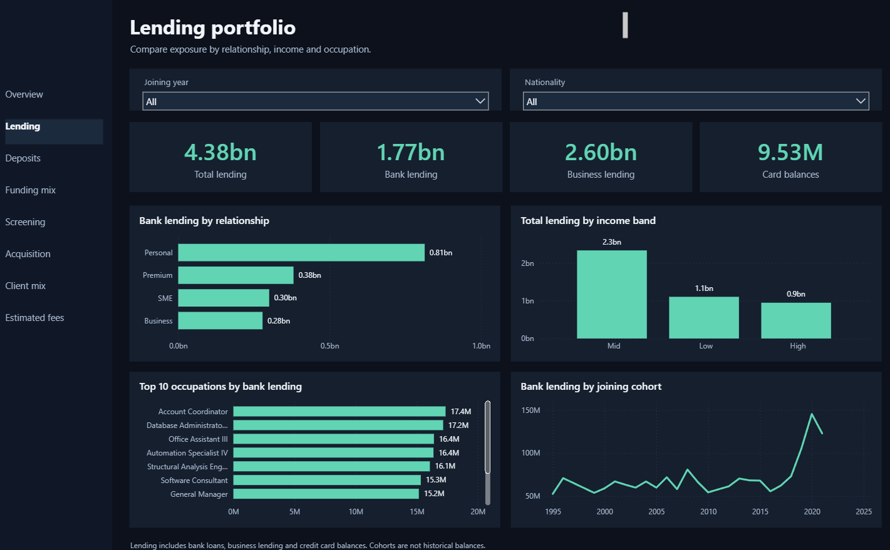
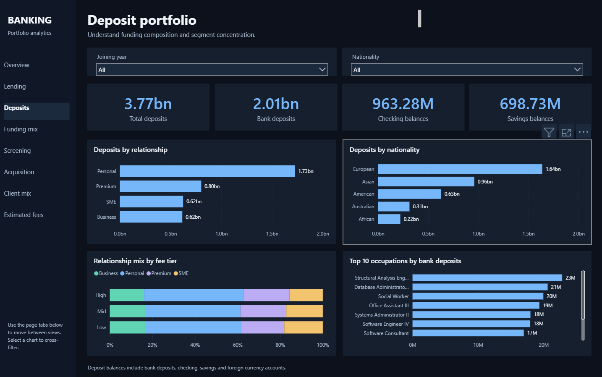
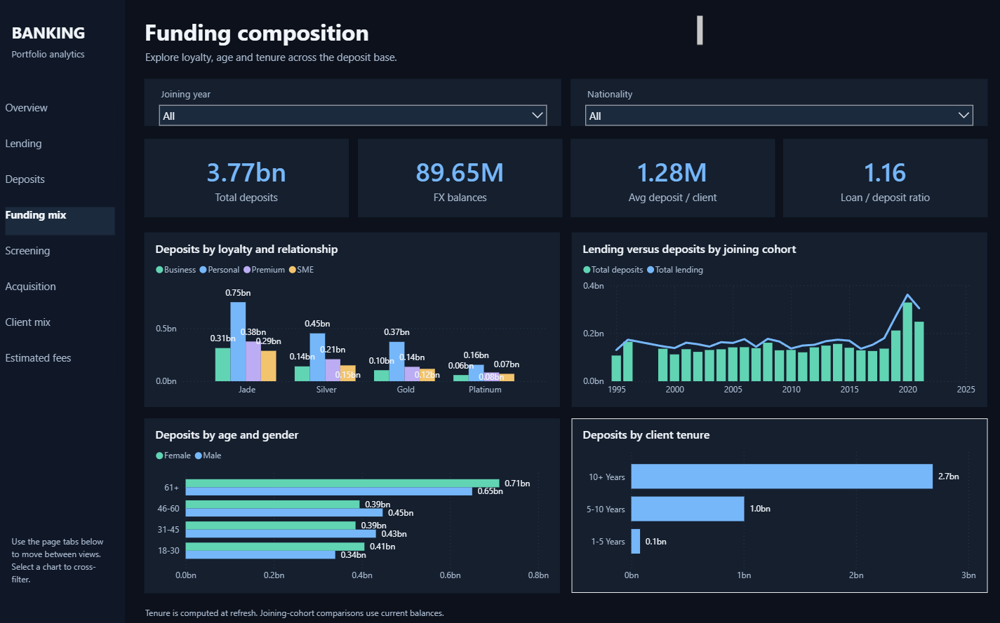
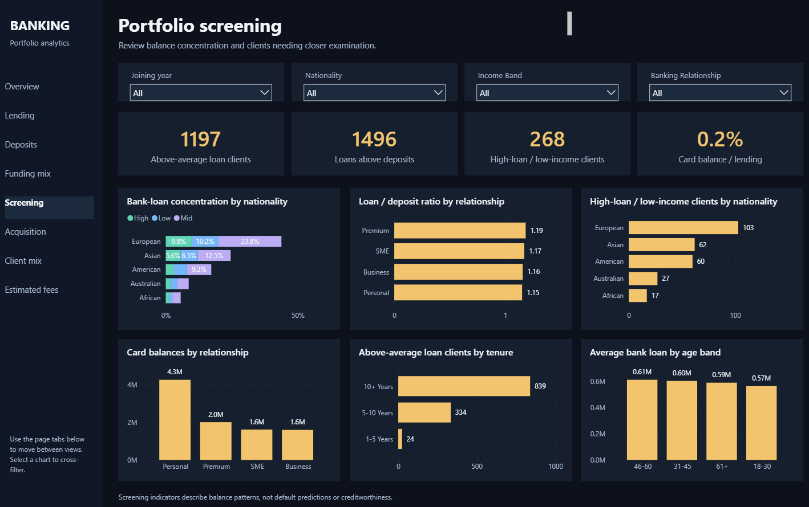
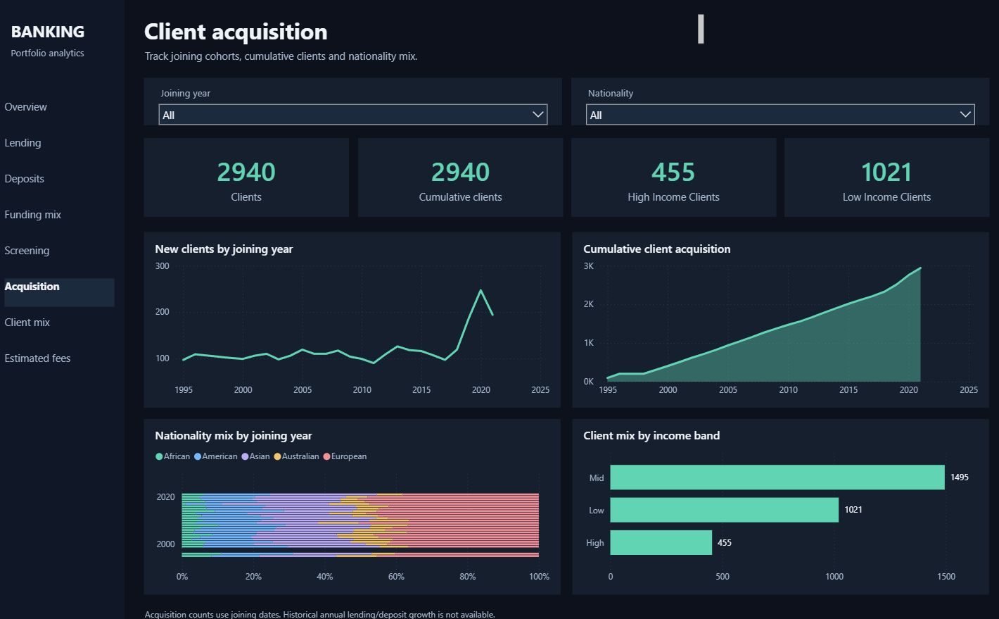
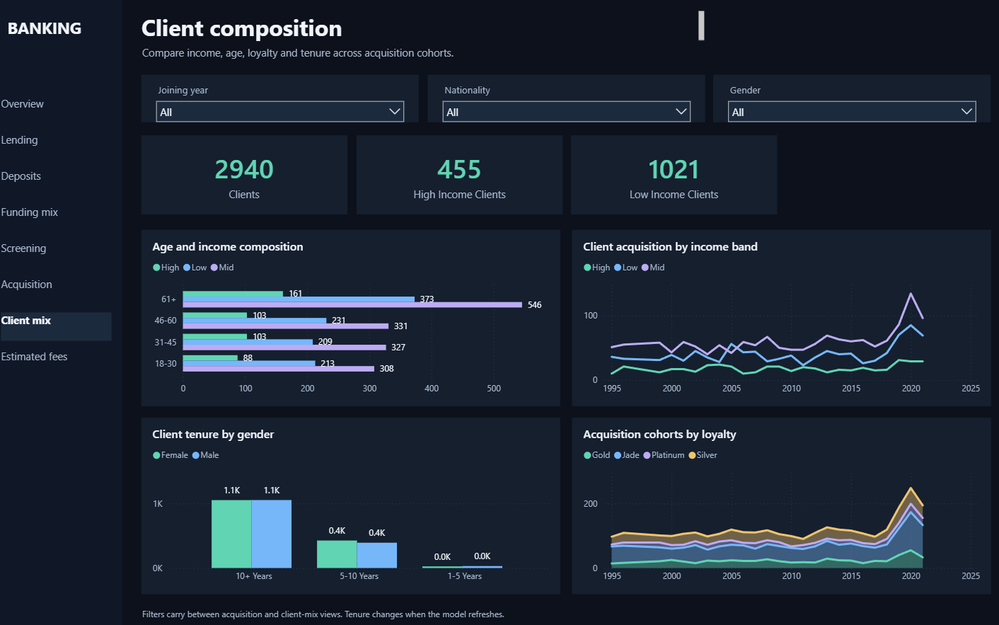
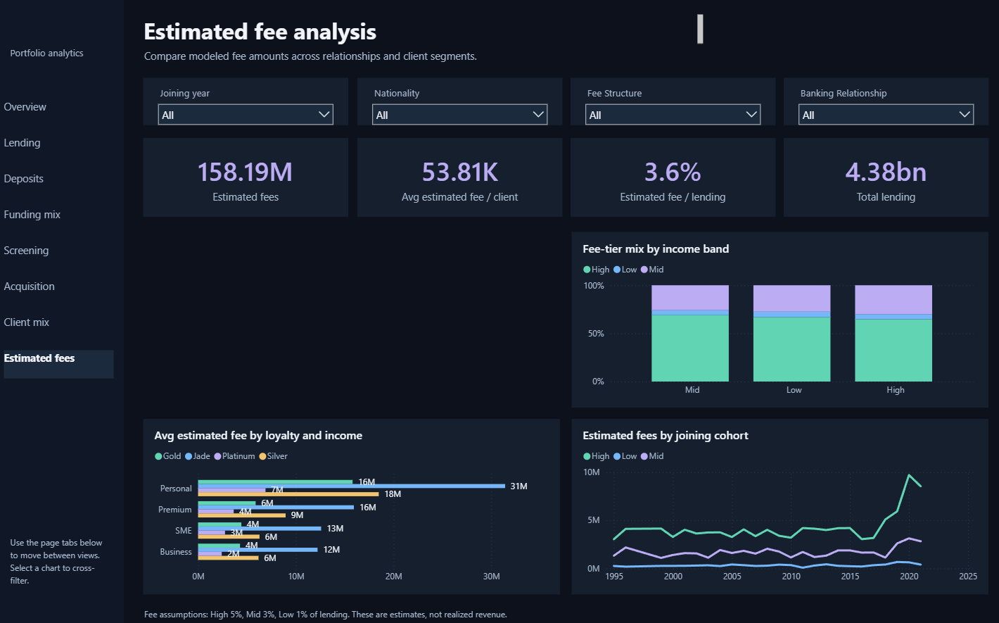

# Banking Portfolio Analytics


## Overview

This project analyses 3,000 banking clients with MySQL, Python, and Power BI. It tracks lending, deposits, client acquisition, balance-based screening indicators, and estimated fees.

The dark Power BI report lives in `powerbi/Banking Dark UI/Banking Dark.pbip`. Open the PBIP in Power BI Desktop, then refresh it against `Banking.csv` if needed.

## Data and metric definitions

| Item | Value |
| --- | ---: |
| Raw client records | 3,000 |
| Default report client count | 2,940 |
| Raw fields | 25 |
| Joining dates | 1995 to 2021 |
| Income bands | Low: under $100K; Mid: $100K to under $300K; High: $300K and above |
| Total lending | $4.38B |
| Total deposits | $3.77B |
| Loan-to-deposit ratio | 1.16 |
| Estimated fees | $158.19M |

`Total lending` combines bank loans, business lending, and credit-card balances. `Total deposits` combines bank deposits, checking accounts, savings accounts, and foreign-currency accounts.

The source file has 3,000 records. The default report visuals count 2,940 records through the Date Table relationship, so report-level client cards and count charts use 2,940.

The report estimates fees from total lending: High fee tier at 5%, Mid at 3%, and Low at 1%. These figures model relative fee potential. They do not represent booked revenue.

## How to read the report

- A category chart compares the current total or count for groups such as relationship, nationality, loyalty, or income band.
- A joining-cohort chart groups current balances by the year a client joined. It does not show historical lending or deposit growth.
- A screening visual applies a balance rule. It does not assign a default-risk rating or credit decision.
- Slicers filter the page and linked report visuals. Use the built-in page tabs at the bottom of Power BI to change pages.

## Dashboard guide

### 1. Portfolio overview



| KPI | Value | Interpretation |
| --- | ---: | --- |
| Clients | 2,940 | The default Date Table relationship includes 2,940 client records in report visuals. |
| Total lending | $4.38B | Lending exposure includes bank loans, business lending, and card balances. |
| Total deposits | $3.77B | Deposits include bank, checking, savings, and foreign-currency balances. |
| Loan / deposit ratio | 1.16 | The dataset holds $1.16 of lending for every $1.00 of deposits. |
| Estimated fees | $158.19M | The fee model applies the project fee assumptions to lending. |

| Visual | Relationship type | Reading and inference |
| --- | --- | --- |
| Current balances by joining cohort | Current balance total grouped by joining year | The 2020 cohort holds the largest current lending balance at $361.43M. Read this as cohort composition, not year-over-year growth. |
| Clients by relationship | Client count by relationship category | Personal Banking leads with 1,333 clients. It forms the largest relationship base. |
| Lending and deposits by loyalty | Current lending and deposit totals by loyalty group | Jade clients hold the largest lending balance at $1.98B and deposits at $1.72B. |
| Client geography | Client count by nationality | European clients form the largest nationality group at 1,299 clients. |

### 2. Lending portfolio



| KPI | Value | Interpretation |
| --- | ---: | --- |
| Total lending | $4.38B | The full lending exposure across all three lending components. |
| Bank lending | $1.77B | Bank loans contribute 40.5% of total lending. |
| Business lending | $2.60B | Business lending contributes 59.3% and drives most lending exposure. |
| Card balances | $9.53M | Card balances contribute 0.2% of total lending. |

| Visual | Relationship type | Reading and inference |
| --- | --- | --- |
| Bank lending by relationship | Bank-loan total by relationship category | Personal Banking leads with $814.22M in bank loans. |
| Total lending by income band | Total lending by income segment | Mid-income clients account for $2.33B, the largest income-band total. |
| Top occupations by bank lending | Ranked bank-loan total by occupation | Account Coordinators lead the displayed ranking at $17.36M. Treat the ranking as concentration, not occupation-level risk. |
| Bank lending by joining cohort | Current bank-loan total grouped by joining year | The 2020 cohort holds $145.48M. It shows the current balance attached to that cohort. |

### 3. Deposit portfolio



| KPI | Value | Interpretation |
| --- | ---: | --- |
| Total deposits | $3.77B | The full funding balance in the source data. |
| Bank deposits | $2.01B | Bank deposits supply 53.5% of total deposits. |
| Checking balances | $963.28M | Checking accounts supply 25.6% of total deposits. |
| Savings balances | $698.73M | Savings accounts supply 18.6% of total deposits. |

| Visual | Relationship type | Reading and inference |
| --- | --- | --- |
| Deposits by relationship | Deposit total by relationship category | Personal Banking holds $1.73B, the largest relationship-level deposit balance. |
| Deposits by nationality | Deposit total by nationality | European clients hold $1.64B, the largest nationality-level deposit balance. |
| Deposits by fee tier | Deposit total by assigned fee tier | The High tier holds $1.89B in deposits. Fee tier describes the project’s fee assumption, not deposit quality. |
| Top occupations by deposits | Ranked deposit total by occupation | Structural Analysis Engineers lead at $41.93M. Use the view to find balance concentration. |

### 4. Funding composition



| KPI | Value | Interpretation |
| --- | ---: | --- |
| Total deposits | $3.77B | The same deposit definition used on the deposit portfolio page. |
| Foreign-currency balances | $89.65M | Foreign-currency accounts make up 2.4% of deposits. |
| Average deposit per client | $1.28M | The mean deposit balance across the 2,940 clients counted by the report. |
| Loan / deposit ratio | 1.16 | The portfolio-level balance comparison. |

| Visual | Relationship type | Reading and inference |
| --- | --- | --- |
| Deposits by loyalty and relationship | Deposit total across two client categories | Jade clients hold $1.72B in deposits. Use the relationship breakdown to locate the contributing client base. |
| Lending versus deposits by joining cohort | Current lending and deposit totals grouped by joining year | The 2020 cohort holds $328.53M in deposits. Compare the two measures as current cohort balances. |
| Deposits by age and gender | Deposit total across demographic categories | Clients aged 61+ hold $1.36B, the largest age-band total. |
| Deposits by client tenure | Deposit total by engagement timeframe | The chart shows where current deposits sit across tenure groups. Refreshing the model recalculates tenure. |

### 5. Portfolio screening



| KPI | Value | Interpretation |
| --- | ---: | --- |
| Above-average loan clients | 1,197 | Clients whose bank-loan balance exceeds the portfolio average. |
| Loans above deposits | 1,496 | Clients whose bank-loan balance exceeds their bank-deposit balance. |
| High-loan / low-income clients | 268 | Low-income clients with above-average bank-loan balances. |
| Card balance / lending | 0.22% | Card balances form a small share of total lending. |

| Visual | Relationship type | Reading and inference |
| --- | --- | --- |
| Bank-loan concentration by nationality | Bank-loan total and share by nationality | European clients hold $777.62M in bank loans, the largest nationality balance. |
| Loan / deposit ratio by relationship | Total lending divided by total deposits for each relationship | Premium leads at 1.19. A ratio above 1 means lending exceeds deposits for that group in this dataset. |
| High-loan / low-income clients by nationality | Count of clients meeting two screening rules | European clients account for 103 of the 268 flagged clients. The rule supports review, not a credit decision. |
| Lending by income band | Lending total by income segment | Mid-income clients hold the largest lending balance. |
| Card balances by loyalty | Card-balance total by loyalty group | The chart identifies where card exposure concentrates across loyalty groups. |
| Average bank loan by age band | Mean bank-loan balance by age band | Ages 46 to 60 lead at $610,968 per client. The mean does not describe every client in the band. |

### 6. Client acquisition



| KPI | Value | Interpretation |
| --- | ---: | --- |
| Clients | 2,940 | Total clients counted by the report. |
| Cumulative clients | 2,940 | The running client count reaches the report total at the latest joining date. |
| High-income clients | 455 | Clients with estimated income of at least $300K. |
| Low-income clients | 1,021 | Clients with estimated income under $100K. |

| Visual | Relationship type | Reading and inference |
| --- | --- | --- |
| New clients by joining year | Client count by joining-year cohort | 2020 adds 248 clients, the largest acquisition cohort. |
| Cumulative client acquisition | Running sum of clients across joining dates | The line rises as each cohort adds clients. It measures client base accumulation. |
| Nationality mix by joining year | Percentage composition of each joining cohort | European clients account for 119 of 248 clients in the 2020 cohort. Compare shares inside each year, not absolute totals across unequal cohorts. |
| Client mix by income band | Client count by income group | Mid-income clients lead with 1,517 clients. |

### 7. Client composition



| KPI | Value | Interpretation |
| --- | ---: | --- |
| Clients | 2,940 | The page uses the report-wide client base. |
| High-income clients | 455 | High-income segment size. |
| Low-income clients | 1,021 | Low-income segment size. |

| Visual | Relationship type | Reading and inference |
| --- | --- | --- |
| Age and income composition | Client count across age and income categories | Ages 61+ form the largest age band with 1,084 clients. Use the chart to compare income mix within age groups. |
| Client acquisition by income band | Joining-cohort counts split by income band | The chart shows when each income segment joined. It does not show income growth over time. |
| Client tenure by gender | Client count by tenure and gender | Female clients number 1,512 and male clients number 1,488. The small gap does not establish a meaningful gender effect. |
| Acquisition cohorts by loyalty | Joining-cohort counts split by loyalty group | Jade is the largest loyalty group with 1,331 clients. |

### 8. Estimated fee analysis



| KPI | Value | Interpretation |
| --- | ---: | --- |
| Estimated fees | $158.19M | Modeled from lending and the assigned fee rate. |
| Average fee per client | $53.81K | Mean modeled fee amount per client. |
| Estimated fee / lending | 3.6% | Modeled fee as a share of total lending. |
| Total lending | $4.38B | The fee model’s balance base. |

| Visual | Relationship type | Reading and inference |
| --- | --- | --- |
| Estimated fees by relationship and loyalty | Modeled fee total across client segments | Personal Banking contributes $72.60M, the largest relationship-level estimate. |
| Fee-tier mix by income band | Percentage mix of assigned fee tiers inside each income band | The High fee tier contributes $107.10M in modeled fees. The tier drives the modeled rate. |
| Average estimated fee by loyalty and income | Mean modeled fee across loyalty and income categories | Jade clients lead at $54,215 on average. Compare averages with client counts and lending balances. |
| Estimated fees by joining cohort | Modeled fee total grouped by joining year | The 2020 cohort contributes $13.45M. It uses current lending balances, not historical revenue. |

## Repository structure

```text
banking-risk-analytics-Portfolio-3-main/
├── Banking.csv
├── README.md
├── sql/Banking_Complete_SQL_analysis.sql
├── python/banking_eda.ipynb.ipynb
├── powerbi/
│   ├── Banking Analysis Dashboard Shabab new.pbix
│   └── Banking Dark UI/Banking Dark.pbip
└── screenshot/dark/
    ├── 01-portfolio-overview.png
    ├── 02-lending-portfolio.png
    ├── 03-deposit-portfolio.png
    ├── 04-funding-composition.png
    ├── 05-portfolio-screening.png
    ├── 06-client-acquisition.png
    ├── 07-client-composition.png
    └── 08-estimated-fees.png
```

## Run the project

1. Run `sql/Banking_Complete_SQL_analysis.sql` in MySQL for the SQL workflow.
2. Open `python/banking_eda.ipynb.ipynb` for exploratory analysis.
3. Open `powerbi/Banking Dark UI/Banking Dark.pbip` in Power BI Desktop.
4. If Power BI cannot locate the CSV, set the source to the repository’s `Banking.csv`, then refresh.

## Limitations

- The dataset does not include default outcomes. Screening visuals identify balance patterns only.
- The source stores current balances and joining dates. It cannot prove historical loan or deposit growth.
- The fee figures rely on the 5%, 3%, and 1% project assumptions.

